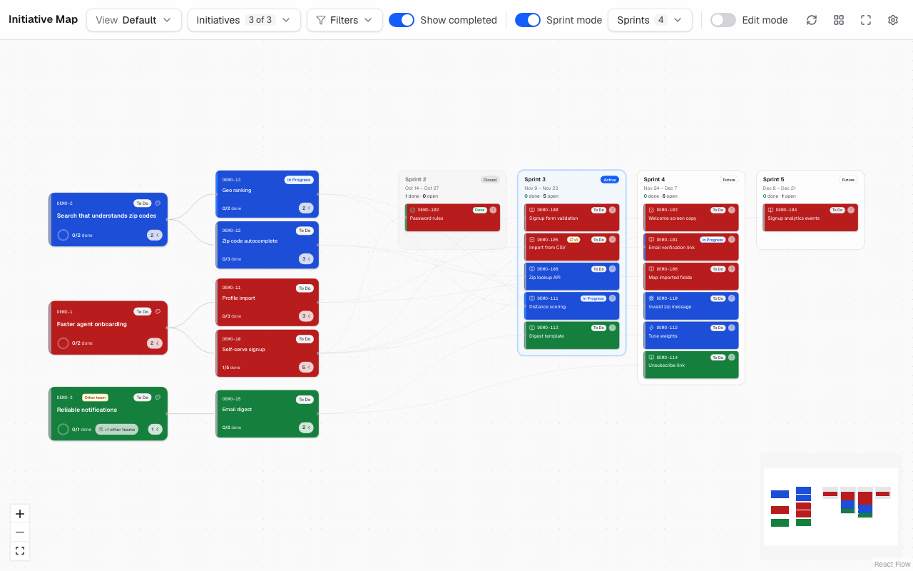
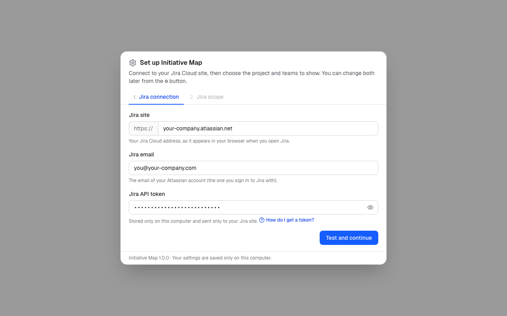
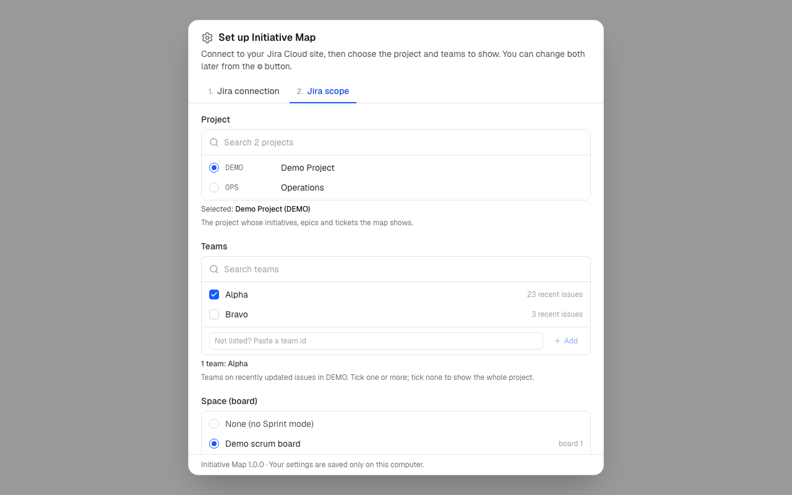

<p align="center"></p>

<h1 align="center">Initiative Map for Jira</h1>

<p align="center">See your team's Jira initiatives, epics and tickets as a mind map, and plan sprints by dragging tickets.</p>



## Download

Pick your computer, download one file, then follow the steps for it below.

| Your computer | Download |
| --- | --- |
| **Mac** (any Mac from the last 10 years, Apple chip or Intel) | [**Initiative-Map-mac.dmg**](https://github.com/albertovt/initiative-map-for-jira-releases/releases/latest/download/Initiative-Map-mac.dmg) |
| **Windows 10 or 11** | [**Initiative-Map-Setup-windows.exe**](https://github.com/albertovt/initiative-map-for-jira-releases/releases/latest/download/Initiative-Map-Setup-windows.exe) |
| **Ubuntu or Debian Linux** | [**Initiative-Map-linux.deb**](https://github.com/albertovt/initiative-map-for-jira-releases/releases/latest/download/Initiative-Map-linux.deb) |
| Other Linux | [Initiative-Map-linux.AppImage](https://github.com/albertovt/initiative-map-for-jira-releases/releases/latest/download/Initiative-Map-linux.AppImage) |

You need a **Jira Cloud** account (your Jira address ends in `.atlassian.net`). Initiative Map doesn't work with self-hosted Jira Server or Data Center.

Older versions and release notes are on the [Releases page](https://github.com/albertovt/initiative-map-for-jira-releases/releases).

---

## Install on a Mac

1. Open the file you downloaded, **Initiative-Map-mac.dmg**. A window opens.
2. Drag **Initiative Map** onto the **Applications** folder in that window.
3. Open your **Applications** folder and double-click **Initiative Map**.

**The first time, your Mac blocks the app.** Initiative Map isn't registered with Apple (registration costs money), so macOS shows a warning such as *"Apple could not verify 'Initiative Map' is free of malware"*. This happens only once:

4. Click **Done** (or **OK**) to close the warning.
5. Open the **Apple menu** (top-left corner) → **System Settings** → **Privacy & Security**.
6. Scroll down to **Security**. Next to *"Initiative Map" was blocked…*, click **Open Anyway**.
7. Enter your Mac password (or use Touch ID), then click **Open Anyway** once more.

From now on, Initiative Map opens normally. You'll find it in Applications and Launchpad; to keep it in the Dock, right-click its Dock icon → **Options** → **Keep in Dock**.

> On macOS 14 (Sonoma) or older you can instead right-click (or Control-click) **Initiative Map** in Applications, choose **Open**, then click **Open**.

## Install on Windows

1. Open the file you downloaded, **Initiative-Map-Setup-windows.exe**.
   - If your browser says the file *isn't commonly downloaded*: click **⋯** (or the arrow) next to it → **Keep** → **Show more** → **Keep anyway**.
2. If a blue box says **"Windows protected your PC"**: click **More info**, then **Run anyway**. (Initiative Map isn't registered with Microsoft, so Windows shows this once.)
3. It installs by itself (no administrator password needed) and opens. A shortcut is added to your desktop and the Start menu.

## Install on Linux

**Ubuntu or Debian (.deb):** double-click **Initiative-Map-linux.deb** and click **Install** (in App Center or Software). Or, in a terminal:

```bash
sudo apt install ./Initiative-Map-linux.deb
```

Then open **Initiative Map** from your applications.

**Other Linux (.AppImage):** right-click **Initiative-Map-linux.AppImage** → **Properties** → **Permissions** → tick **Allow executing file as program**, then double-click it. If nothing happens, install `libfuse2` (for example `sudo apt install libfuse2`), or use the .deb.

---

## First start: connect to your Jira

The first time Initiative Map opens, it asks for three things. Have your Jira open in your browser to copy them.



1. **Jira site**: your Jira address, for example `your-company.atlassian.net`. Copy it from your browser's address bar when Jira is open.
2. **Jira email**: the email you sign in to Jira with.
3. **Jira API token**: a password-like key that lets Initiative Map read Jira as you. To get one:
   1. Open [id.atlassian.com → Security → API tokens](https://id.atlassian.com/manage-profile/security/api-tokens) and sign in.
   2. Click **Create API token**. Use this one, **not** *Create API token with scopes*.
   3. Give it a name, such as `Initiative Map`, choose an expiry date and click **Create**.
   4. Click **Copy**. Jira shows the token only once.
   5. Paste it into **Jira API token** (⌘V on a Mac, Ctrl+V on Windows and Linux).

   The **How do I get a token?** link in the app shows these steps too, and the eye button shows or hides what you pasted.
4. Click **Test and continue**. Initiative Map checks the details with Jira. Nothing is saved until Jira accepts them.

Next, choose what to show:



5. **Project**: the Jira project your team works in.
6. **Teams**: tick your team (or several). Tick none to see the whole project.
7. **Space (board)**: your team's scrum board, whose sprints the app shows.
8. Click **Save and open the map**.

You can change all of this later with the **⚙** button in the top-right corner.

## Using Initiative Map

- **Initiatives** (top bar) chooses which initiatives are on the map. Click the number button on a bubble to show its epics, and on an epic to show its tickets.
- **Drag** any bubble to arrange the map. Positions are saved.
- **Click** a bubble for its details and an **Open in Jira** link.
- **Sprint mode** lines your tickets up in sprint columns.
- **Edit mode** lets you change sprints in Jira by dragging tickets: into a sprint, to another sprint, to **Other · backlog** to take a ticket out of its sprint, or up and down to change its order. Each change is saved to Jira right away, with an **Undo** button. Your Jira account needs permission to schedule and edit issues.
- **Colors**: each initiative, its epics and its tickets share a color. Click the palette icon on an initiative to change it. **⚙ → Colors** switches between dark and light colors.
- **Views** (top left) save different setups, such as "Q4 review" or "Planning".

## Updating

When a new version is out, a blue bar at the top of the app says so. Click **Download**, then install it the same way as the first time:

- **Mac**: drag the new Initiative Map onto Applications and choose **Replace**.
- **Windows**: run the new installer.
- **Linux**: install the new .deb or replace the AppImage.

Your Jira connection, views and colors are kept.

## Your data and privacy

- Everything Initiative Map saves (your Jira site, email and token, your views and colors) stays **on your computer**, in a file only your user account can read:
  - Mac: `~/Library/Application Support/Initiative Map`
  - Windows: `%APPDATA%\Initiative Map`
  - Linux: `~/.config/Initiative Map`
- Initiative Map talks only to **your Jira site**, and once or twice a day to **GitHub** to check for a new version. There are no accounts, ads or tracking.
- It can't change anything in Jira except, in Edit mode, which sprint a ticket is in and its order.

## Uninstalling

- **Mac**: drag **Initiative Map** from Applications to the Trash.
- **Windows**: **Settings** → **Apps** → **Installed apps** → **Initiative Map** → **Uninstall**.
- **Linux**: `sudo apt remove initiative-map-for-jira`, or delete the AppImage.

To also remove your saved settings, delete the data folder listed above. You can also revoke the API token at [id.atlassian.com](https://id.atlassian.com/manage-profile/security/api-tokens).

## Something not working?

| What you see | What to do |
| --- | --- |
| *"Jira rejected the email or API token"* | Check the email matches your Jira account, or create a new token (the plain **Create API token**, not the one *with scopes*) and paste it in **⚙ → Jira connection**. |
| The map is empty | Check **⚙ → Jira scope**: the project and team must be ones you can see in Jira. Then pick initiatives from the **Initiatives** menu. |
| Your team isn't in the Teams list | The list shows teams on recently updated issues. Paste the team's id in **Not listed? Paste a team id**. |
| **Edit mode** is greyed out | Choose a board in **⚙ → Jira scope**, and wait for tickets and sprints to load. |
| The Mac says the app *"is damaged"* | Download it again, then follow the **Open Anyway** steps above. |
| Anything else | In the app, open **Help** → **Show the log file** (on Windows and Linux, press **Alt** to show the menu), and send the file to the person who shared Initiative Map with you. |
